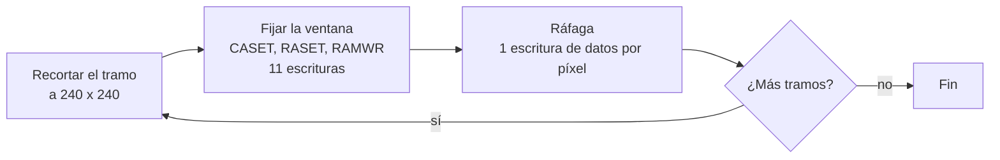
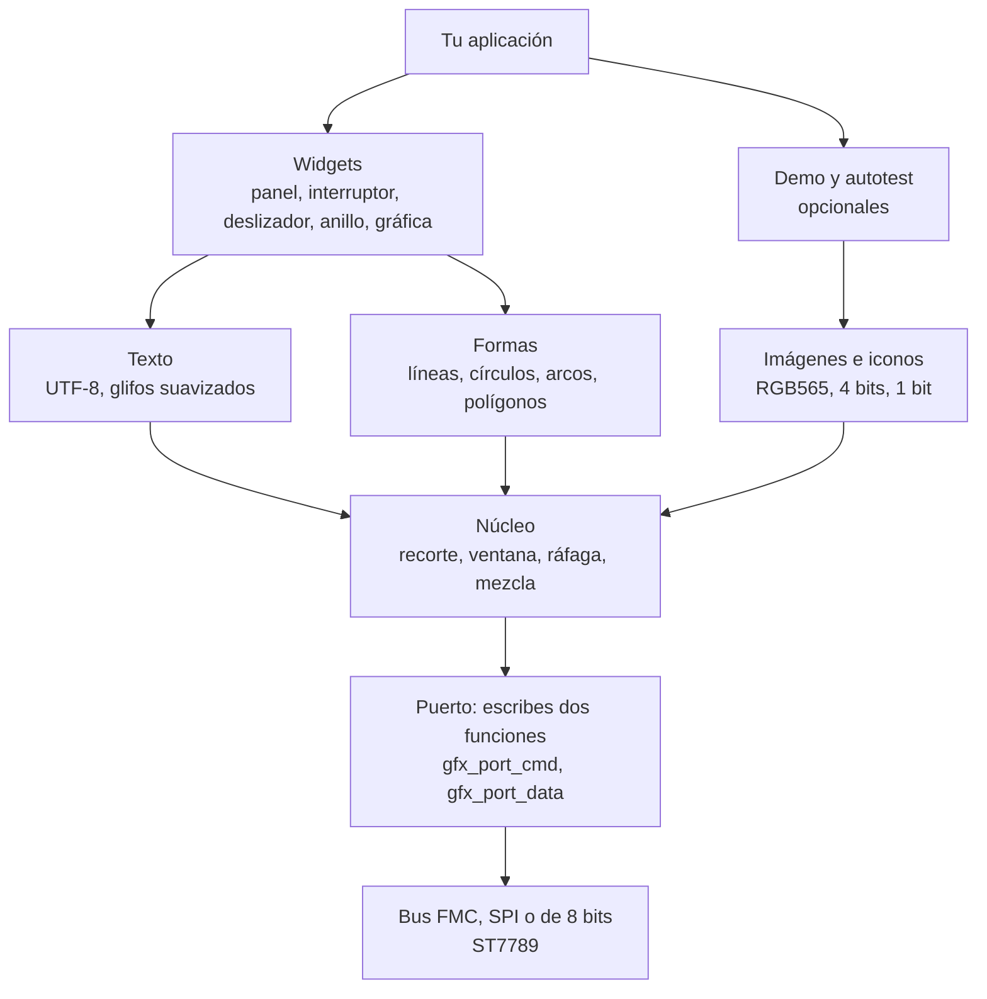

# stm32-st7789-gfx

**Biblioteca gráfica en C portable para pantallas ST7789 en STM32.** Formas, texto suavizado, iconos, imágenes y widgets para paneles de 240 x 240 en RGB565, con bus FMC de 16 bits, SPI o bus de 8 bits. La conexión con el hardware son dos funciones, las matemáticas usan solo enteros y todo el dibujo se prueba en el PC.

[](https://github.com/JuanP-G/stm32-st7789-gfx/actions/workflows/ci.yml)
[](LICENSE)

[](https://juanp-g.github.io/stm32-st7789-gfx/es/)

[English](README.md) | Español | [Web en español](https://juanp-g.github.io/stm32-st7789-gfx/es/)

<p align="center">
  
</p>

*Todas las imágenes de esta página las ha dibujado la propia biblioteca, sobre el modelo del PC, con `make shots`.*

La documentación técnica completa (guía de integración, arquitectura, referencia de la API) está en inglés en la [web del proyecto](https://juanp-g.github.io/stm32-st7789-gfx/). Este documento resume lo necesario para empezar en español.

## Contenido

- [Por qué esta biblioteca](#por-qué-esta-biblioteca)
- [Características](#características)
- [Cómo dibuja](#cómo-dibuja)
- [Inicio rápido](#inicio-rápido)
- [El puerto: FMC, SPI y bus de 8 bits](#el-puerto-fmc-spi-y-bus-de-8-bits)
- [Versión de un solo header](#versión-de-un-solo-header)
- [Pruebas](#pruebas)
- [Problemas típicos](#problemas-típicos)
- [Límites conocidos](#límites-conocidos)
- [Estructura del repositorio](#estructura-del-repositorio)
- [Licencia y créditos](#licencia-y-créditos)

## Por qué esta biblioteca

Manejar una ST7789 paralela desde un STM32 es fácil de empezar y difícil de hacer rápido. Si cada píxel se envía con su propia ventana de direcciones, cada píxel cuesta 12 escrituras al bus y una pantalla completa necesita 691.200. Esta biblioteca fija la ventana una vez por tramo de píxeles y después envía los píxeles seguidos. Rellenar la pantalla baja a 57.611 escrituras, y rectángulos, círculos, texto e imágenes cuestan entre 8 y 12 veces menos que pixel a pixel.

## Características

| Área | Qué incluye |
|---|---|
| Formas | Líneas, líneas gruesas, rectángulos, rectángulos redondeados, círculos, anillos, arcos, triángulos y polígonos rellenos (regla par-impar), degradados |
| Texto | Seis fuentes proporcionales derivadas de DejaVu Sans, 4 bits por píxel, entrada UTF-8 para Latin-1, cajas de texto con alineación |
| Iconos e imágenes | 32 iconos con opacidad de 4 bits, imágenes RGB565, mapas de 1 bit y un script para convertir tus propias imágenes |
| Widgets | Panel, botón, interruptor, casilla, deslizador, barra de progreso, indicador circular, gráfica de línea, insignia, número grande, elemento de lista, barra de pestañas, barra de estado, temas oscuro y claro |
| Hardware | Dos funciones por implementar: `gfx_port_cmd()` y `gfx_port_data()` |
| Matemáticas | Solo enteros: sin float, sin `malloc`, tabla de senos en Q14 y raíz cuadrada entera |
| Pruebas | Modelo del controlador en el PC, hashes de píxeles de referencia, benchmark de escrituras, compilación C99 estricta y para Cortex-M7 |
| Puesta en marcha | `gfx_selftest`: nueve patrones que hacen evidentes los fallos de cableado y configuración |
| Empaquetado | `include/` y `src/` normales, o un único header al estilo stb, `single_header/lcd_gfx.h` |

## Cómo dibuja

Cada primitiva recorta su rectángulo a la pantalla, fija la ventana del controlador una vez con CASET, RASET y RAMWR, y envía una palabra de datos por píxel. El controlador avanza por la ventana él solo.



<p align="center">
  
</p>

Un rectángulo relleno de *w* x *h* cuesta *w* x *h* + 11 escrituras. Las formas que no son rectángulos se pintan fila a fila, así que pagan las 11 escrituras de preparación por fila en lugar de 12 escrituras por píxel. Los diagramas están en inglés, como el resto de la documentación técnica.

### Capas

Cada módulo solo llama a los de debajo. El núcleo es el único que habla con el puerto, así que todo lo de encima no depende del hardware.



### Coste medido

Escrituras al bus contadas en el modelo del PC con `make bench`, frente a un controlador pixel a pixel:

| Operación | Ventana y ráfaga | Pixel a pixel | Proporción |
|---|---:|---:|---:|
| Línea horizontal, 200 px | 211 | 2.400 | 11,4x |
| Rectángulo relleno, 100 x 60 | 6.011 | 72.000 | 12,0x |
| Círculo relleno, radio 60 | 12.844 | 138.156 | 10,8x |
| Texto, 12 caracteres | 1.918 | 21.432 | 11,2x |
| Icono, 32 x 32 | 1.035 | 12.288 | 11,9x |
| Imagen, 120 x 80 | 9.611 | 115.200 | 12,0x |
| Pantalla completa | 57.611 | 691.200 | 12,0x |
| Página dashboard de la demo | 157.844 | 1.747.740 | 11,1x |

## Inicio rápido

1. Añade `include/` y `src/` a tu proyecto, o copia [`single_header/lcd_gfx.h`](#versión-de-un-solo-header).
2. Implementa las dos funciones del puerto (más abajo).
3. Inicializa el controlador en tu propio código (salir de reposo, formato de píxel de 16 bits, control de acceso a memoria, encender la pantalla) y dibuja:

```c
#include "gfx_core.h"
#include "gfx_fonts.h"
#include "gfx_text.h"
#include "gfx_widgets.h"

void ui_demo(void)
{
    gfx_set_theme(&gfx_theme_dark);
    gfx_fill_screen(gfx_theme->background);
    gfx_widget_status_bar("Hola", 82, 1);
    gfx_widget_ring(62, 110, 40, 9, 73, gfx_theme->accent, "73%");
    gfx_text(120, 100, "CPU", &gfx_font_sans_16, gfx_theme->text, gfx_theme->background);
}
```

Para ver todo lo que sabe hacer, recorre las páginas de la demo:

```c
#include "gfx_demo.h"

for (int page = 0; page < gfx_demo_page_count(); page++) {
    gfx_demo_page(page);
    HAL_Delay(3000);
}
```

Puedes probar este código en el PC antes de tocar la placa: [`examples/host_quickstart.c`](examples/host_quickstart.c) se compila y se ejecuta con `make examples`.

## El puerto: FMC, SPI y bus de 8 bits

La biblioteca necesita dos funciones, declaradas en [`gfx_port.h`](include/gfx_port.h):

```c
void gfx_port_cmd(uint8_t command);   /* escribe un byte de comando  (A0 / D/C = 0) */
void gfx_port_data(uint16_t data);    /* escribe una palabra de datos (A0 / D/C = 1) */
```

`gfx_port_data()` transporta dos tipos de datos: parámetros de 8 bits (byte bajo) después de CASET y RASET, y píxeles RGB565 de 16 bits después de RAMWR. Con un FMC de 16 bits da igual. Con SPI o bus de 8 bits hay que recordar el último comando y enviar un byte para los parámetros y dos bytes, primero el alto, para los píxeles.

**FMC de 16 bits.** El FMC genera `FMC_A0` a partir del bit 1 de la dirección, así que una escritura en la base del banco es un comando y una escritura en base + 2 es un dato. Conecta `FMC_A0` al pin D/CX del controlador.

```c
#define LCD_BASE 0x64000000u                              /* FMC_NE2: ajusta a tu chip select */
#define LCD_REG  (*(volatile uint16_t *)(LCD_BASE))       /* A0 = 0: comando */
#define LCD_RAM  (*(volatile uint16_t *)(LCD_BASE + 2u))  /* A0 = 1: dato    */

void gfx_port_cmd(uint8_t command) { LCD_REG = command; }
void gfx_port_data(uint16_t data)  { LCD_RAM = data;    }
```

| Chip select | Base del banco | Chip select | Base del banco |
|---|---|---|---|
| `FMC_NE1` | `0x60000000` | `FMC_NE3` | `0x68000000` |
| `FMC_NE2` | `0x64000000` | `FMC_NE4` | `0x6C000000` |

Hay puertos completos para los tres buses en [`examples/`](examples): [`port_fmc.c`](examples/port_fmc.c), [`port_spi.c`](examples/port_spi.c) y [`port_8bit.c`](examples/port_8bit.c). `make test` los compila con avisos estrictos para que sigan encajando con las cabeceras.

| Bus | `gfx_port_cmd` | `gfx_port_data` |
|---|---|---|
| FMC de 16 bits | escribir 16 bits en la base del banco | escribir 16 bits en base + 2 |
| SPI de 4 hilos | D/C a 0, enviar 1 byte, recordar el comando | D/C a 1; tras RAMWR enviar 2 bytes (alto primero), si no 1 byte |
| Bus de 8 bits | D/C a 0, un pulso de WR, recordar el comando | D/C a 1; tras RAMWR dos pulsos de WR (alto primero), si no uno |

### STM32CubeIDE

1. Copia `include/` y `src/` en tu proyecto, por ejemplo en `Drivers/stm32-st7789-gfx`.
2. En **Project > Properties > C/C++ General > Paths and Symbols**, añade `src` como ubicación de código e `include` a las rutas de includes de GNU C.
3. Conserva `-ffunction-sections -fdata-sections` y `-Wl,--gc-sections` para que se descarten las fuentes e iconos sin usar.
4. Guarda tus ficheros en UTF-8 para que cadenas como `"25 °C"` lleguen intactas.
5. En CubeMX, activa FMC en modo NOR/SRAM con bus de datos de 16 bits, tu chip select y la línea de dirección A0. Ajusta los tiempos de preparación de dirección y datos a la hoja de datos del panel.

[`examples/cubeide_main_snippet.c`](examples/cubeide_main_snippet.c) muestra dónde van los bucles del autotest y de la demo en `main.c`.

## Versión de un solo header

[`single_header/lcd_gfx.h`](single_header/lcd_gfx.h) lo genera `tools/make_single_header.py` al estilo de las bibliotecas stb. Inclúyelo donde quieras para tener las declaraciones. En un único fichero `.c`, define antes `GFX_IMPLEMENTATION` para compilar la implementación:

```c
#define GFX_IMPLEMENTATION
#include "lcd_gfx.h"
```

| Macro | Efecto |
|---|---|
| `GFX_IMPLEMENTATION` | Compila la implementación en esta unidad de traducción |
| `GFX_WITHOUT_DEMO` | Deja fuera las páginas de la demo |
| `GFX_WITHOUT_SELFTEST` | Deja fuera los patrones de prueba |

`make header` lo regenera, y `make test` falla si la copia del repositorio se ha desviado de las fuentes. Una prueba compila el header único desde dos unidades de traducción y exige que cada página de la demo dé los mismos píxeles que la versión de varios ficheros.

## Pruebas

Casi todo se comprueba en el PC. El modelo de [`tests/host/sim.c`](tests/host/sim.c) implementa CASET, RASET y RAMWR como describe la hoja de datos, guarda una memoria de imagen de 240 x 320, cuenta cada escritura al bus y señala cualquier píxel que caiga fuera de la ventana.

```sh
make test
```

Necesitas `make`, un compilador de C y Python 3. Clang, el compilador cruzado de Arm y Pillow son opcionales en local, y la integración continua los ejecuta todos.

| Paso | Qué comprueba |
|---|---|
| `header-check` | El header único del repositorio coincide con la salida del generador |
| `host` | 56 comprobaciones de la biblioteca más 13 del autotest, con la versión de varios ficheros |
| `single` | Las mismas 69 comprobaciones con el header único, desde dos unidades de traducción |
| `equiv` | Cada una de las 16 páginas de demo y autotest da el mismo hash FNV-1a del fotograma de 240 x 240 en ambas versiones y en [`tests/golden/pages.golden`](tests/golden/pages.golden) |
| `bench` | Escrituras al bus por primitiva frente a pixel a pixel |
| `strict` | `-std=c99 -Wall -Wextra -pedantic -Werror` con gcc |
| `clang` | Lo mismo con clang; se omite si no está instalado |
| `arm` | Compilación cruzada para Cortex-M7 con `arm-none-eabi-gcc`; se omite si no está instalado |
| `examples` | El ejemplo de inicio rápido se ejecuta y los tres ficheros de puerto compilan |
| `site` | Enlaces, anclas, títulos, descripciones, URL canónicas, JSON-LD e imagen social de la web |

Si cambias a propósito lo que dibuja una página, ejecuta `make golden` y explica el motivo en la solicitud de cambios. Cualquier otro cambio de un píxel rompe la compilación.

### Patrones de prueba para la placa

`gfx_selftest_page(n)` dibuja nueve patrones para la puesta en marcha. Ejecútalos antes que la demo.

| Página | Patrón | Fallo que revela |
|---|---|---|
| 0 | Barras de color | Rojo y azul cambiados |
| 1 | Rampa de grises | Bandas, formato de píxel erróneo, bits de datos sin conectar |
| 2 | Marco y esquinas de colores distintos | Espejo, desplazamientos |
| 3 | Rejilla, cruz y círculo | Distorsión, ventana o resolución erróneas |
| 4 | Rectángulos anidados | Márgenes desiguales, la ventana se envuelve |
| 5 | Texto e iconos | Texto espejado, problemas de codificación |
| 6, 7, 8 | Pantallas lisas roja, verde y azul | Ruido, líneas de datos pegadas |

<p align="center">
  
</p>

## Problemas típicos

| Síntoma | Causa probable | Qué hacer |
|---|---|---|
| Imagen espejada o boca abajo | Bits de orden de filas o columnas de MADCTL (`0x36`) | Invierte MX (`0x40`) o MY (`0x80`) en la inicialización |
| Rojo y azul cambiados | El bit BGR de MADCTL (`0x08`), u orden de bytes en SPI y bus de 8 bits | Cambia BGR; envía primero el byte alto |
| Desplazamiento, franja con contenido erróneo | La RAM del controlador es de 240 x 320 y el módulo muestra una parte | Elige la orientación cuya zona visible empieza en la fila 0 |
| Ruido, nieve, colores erróneos | Temporización del bus demasiado rápida, línea de datos sin conectar, ancho de bus erróneo | Alarga los tiempos de preparación del FMC y revisa cada línea D con las pantallas lisas |
| Colores apagados o con bandas | Formato de píxel que no es de 16 bits (COLMOD `0x3A` = `0x55`) | Configúralo en la inicialización |
| Los acentos salen como `?` | El fichero no está en UTF-8, o un carácter por encima de U+00FF | Guarda en UTF-8; las fuentes llegan hasta U+00FF |

La tabla completa, con el patrón que delata cada fallo, está en la [guía de inicio](https://juanp-g.github.io/stm32-st7789-gfx/getting-started.html#troubleshooting) (en inglés).

## Límites conocidos

- **Sin rotación.** La biblioteca dibuja en la orientación nativa de 240 x 240. Usa los bits de MADCTL en tu inicialización para otra orientación.
- **Flash.** Las seis fuentes ocupan unos 141 KB y los 32 iconos 16 KB. El enlazador descarta lo que no uses si la recolección de secciones está activa.
- **Solo Latin-1.** Los demás caracteres se dibujan como `?`. La fuente negrita de 48 px solo tiene dígitos, los dos puntos y el signo de grado.
- **Tamaño fijo.** `GFX_WIDTH` y `GFX_HEIGHT` valen 240.
- **Solo escritura.** No se lee nada de vuelta del controlador.
- **Sin DMA** incorporado. El bucle de ráfaga llama a `gfx_port_data()` una vez por píxel, y puedes hacer tu puerto tan rápido como permita tu hardware.

## Estructura del repositorio

```text
include/            cabeceras públicas (comentarios Doxygen)
src/                fuentes de la biblioteca, tipografías e iconos como datos const
single_header/      lcd_gfx.h, generado (estilo stb)
examples/           inicio rápido en PC, puertos FMC / SPI / 8 bits, extracto de CubeIDE
tests/host/         modelo del controlador, pruebas, hashes de páginas, benchmark
tests/golden/       hashes de píxeles de referencia de 16 páginas
tools/              generadores (fuentes, iconos, imágenes, header único, web) y comprobaciones
assets/             capturas de cada página de demo y de prueba
docs/               la web, generada por tools/build_site.py desde site_src/
site_src/           fuentes de las páginas y hoja de estilos de la web
.github/workflows/  integración continua: pruebas con gcc y clang, despliegue en GitHub Pages
Makefile            make test lo ejecuta todo
```

## Licencia y créditos

Código bajo licencia [MIT](LICENSE), copyright 2026 Juan Pastrana. Las fuentes de mapa de bits derivan de DejaVu Sans y conservan su licencia; consulta [THIRD_PARTY_NOTICES.md](THIRD_PARTY_NOTICES.md). Si usas la biblioteca en investigación o docencia, [CITATION.cff](CITATION.cff) tiene la referencia. Las contribuciones son bienvenidas: consulta [CONTRIBUTING.md](CONTRIBUTING.md) y el [registro de cambios](CHANGELOG.md).

La biblioteca nació como la práctica 7 de la asignatura de Procesadores y Sistemas Digitales (PSyD) de la Universidad Complutense de Madrid (UCM), escrita para la placa STM32F723E-DISCO, y se ha convertido en un proyecto independiente.
