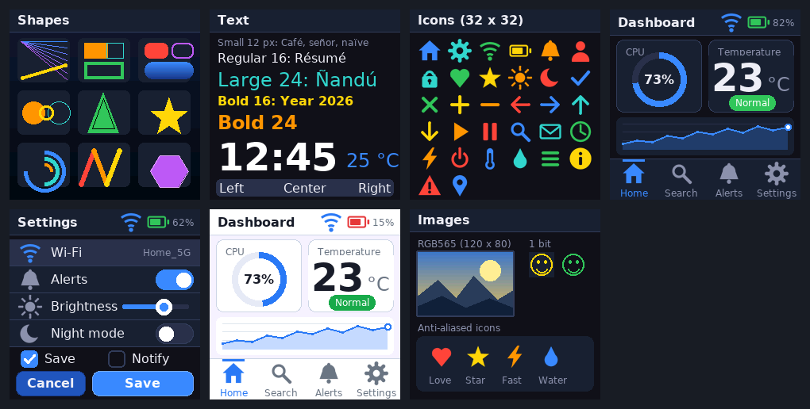
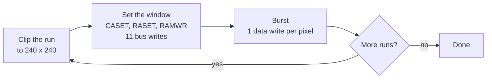
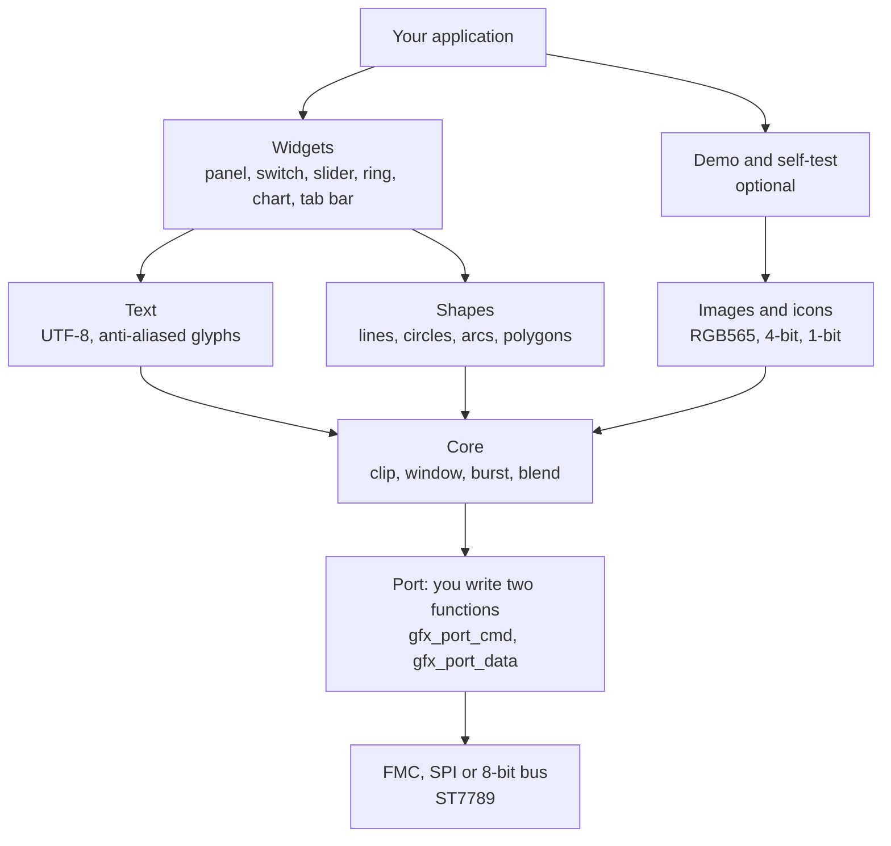
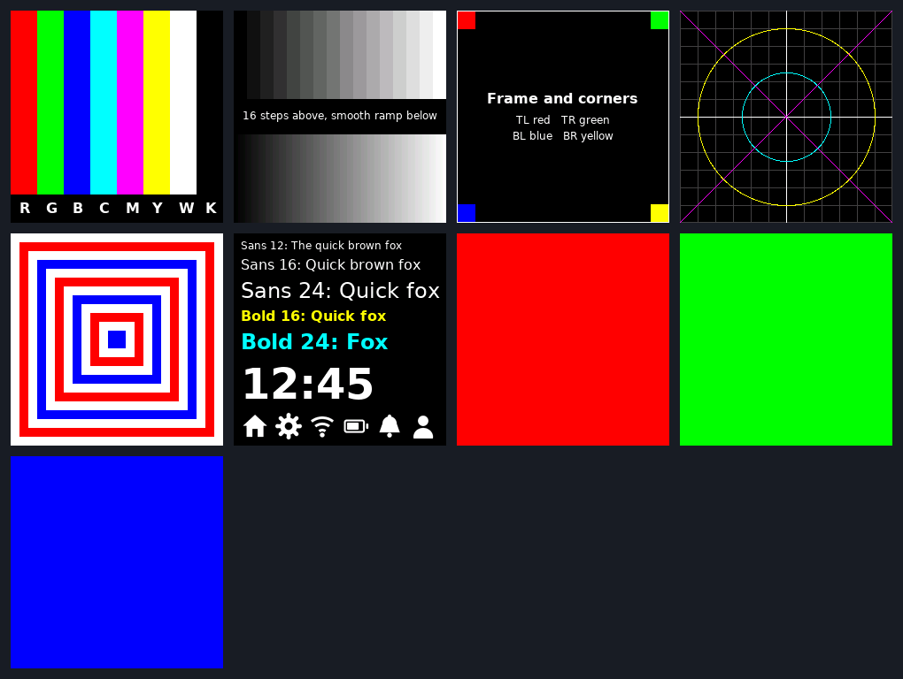

# stm32-st7789-gfx

**A portable C graphics library for ST7789 displays on STM32.** Shapes, anti-aliased text, icons, images and widgets for 240 x 240 RGB565 panels, driven over a 16-bit FMC bus, SPI or an 8-bit bus. The hardware connection is two functions, the maths is integer only, and every drawing path is tested on a PC.

[](https://github.com/JuanP-G/stm32-st7789-gfx/actions/workflows/ci.yml)
[](LICENSE)

[](https://juanp-g.github.io/stm32-st7789-gfx/)

English | [Español](README.es.md) | [Website](https://juanp-g.github.io/stm32-st7789-gfx/)

<p align="center">
  
</p>

*Every image on this page was drawn by the library itself, on the PC model, by `make shots`.*

## Contents

- [Why this library](#why-this-library)
- [Features](#features)
- [How it draws](#how-it-draws)
- [Quick start](#quick-start)
- [The port: FMC, SPI and 8-bit](#the-port-fmc-spi-and-8-bit)
- [Single-header build](#single-header-build)
- [Testing](#testing)
- [Typical problems](#typical-problems)
- [Known limits](#known-limits)
- [Repository layout](#repository-layout)
- [Documentation](#documentation)
- [License and credits](#license-and-credits)

## Why this library

Driving a parallel ST7789 from an STM32 is easy to start and hard to make fast. If every pixel is sent with its own address window, each pixel costs 12 bus writes, and a full screen needs 691,200 of them. This library sets the window once per run of pixels and then streams the pixels back to back. A full-screen fill drops to 57,611 writes, and rectangles, circles, text and images are 8 to 12 times cheaper than the pixel-by-pixel approach.

## Features

| Area | What you get |
|---|---|
| Shapes | Lines, thick lines, rectangles, rounded rectangles, circles, rings, arcs, triangles and filled polygons (even-odd rule), gradients |
| Text | Six proportional fonts derived from DejaVu Sans, 4 bits per pixel, UTF-8 input for Latin-1, text boxes with alignment |
| Icons and images | 32 icons with 4-bit opacity, RGB565 images, 1-bit bitmaps, a converter script for your own pictures |
| Widgets | Panel, button, switch, check box, slider, progress bar, ring gauge, line chart, badge, big number, list item, tab bar, status bar, dark and light themes |
| Hardware | Two functions to implement: `gfx_port_cmd()` and `gfx_port_data()` |
| Maths | Integers only: no float, no `malloc`, a Q14 sine table, an integer square root |
| Testing | PC model of the controller, golden pixel hashes, bus-write benchmark, strict C99 builds, Cortex-M7 cross-compile |
| Bring-up | `gfx_selftest`: nine patterns that make wiring and configuration faults obvious |
| Packaging | Plain `include/` and `src/`, or one stb-style header, `single_header/lcd_gfx.h` |

## How it draws

Each primitive clips its rectangle to the screen, sets the controller window once with CASET, RASET and RAMWR, and then sends one data word per pixel. The controller advances through the window by itself.



<p align="center">
  
</p>

A filled *w* x *h* rectangle costs *w* x *h* + 11 writes. Shapes that are not rectangles are painted one run per row, so they pay the 11-write set-up per row instead of 12 writes per pixel.

### Layers

Each module only calls the ones below it. The core is the only module that talks to the port, so everything above it is hardware-independent.



The same structure as a drawing, with the code you own marked by dashed boxes:

<p align="center">
  
</p>

### Measured cost

Bus writes counted on the PC model with `make bench`, against a pixel-by-pixel driver:

<p align="center">
  
</p>

| Operation | Window and burst | Pixel by pixel | Ratio |
|---|---:|---:|---:|
| Horizontal line, 200 px | 211 | 2,400 | 11.4x |
| Filled rectangle, 100 x 60 | 6,011 | 72,000 | 12.0x |
| Filled circle, radius 60 | 12,844 | 138,156 | 10.8x |
| Text, 12 characters | 1,918 | 21,432 | 11.2x |
| Icon, 32 x 32 | 1,035 | 12,288 | 11.9x |
| Image, 120 x 80 | 9,611 | 115,200 | 12.0x |
| Full screen | 57,611 | 691,200 | 12.0x |
| Dashboard demo page | 157,844 | 1,747,740 | 11.1x |

## Quick start

1. Add `include/` and `src/` to your project, or copy [`single_header/lcd_gfx.h`](#single-header-build).
2. Implement the two port functions (below).
3. Initialise the controller in your own code (sleep out, 16-bit pixel format, memory access control, display on), then draw:

```c
#include "gfx_core.h"
#include "gfx_fonts.h"
#include "gfx_text.h"
#include "gfx_widgets.h"

void ui_demo(void)
{
    gfx_set_theme(&gfx_theme_dark);
    gfx_fill_screen(gfx_theme->background);
    gfx_widget_status_bar("Hello", 82, 1);
    gfx_widget_ring(62, 110, 40, 9, 73, gfx_theme->accent, "73%");
    gfx_text(120, 100, "CPU load", &gfx_font_sans_16, gfx_theme->text, gfx_theme->background);
}
```

To see everything the library can do, loop over the demo pages:

```c
#include "gfx_demo.h"

for (int page = 0; page < gfx_demo_page_count(); page++) {
    gfx_demo_page(page);
    HAL_Delay(3000);
}
```

You can try this code on a PC before you touch a board. [`examples/host_quickstart.c`](examples/host_quickstart.c) is built and run by `make examples`.

## The port: FMC, SPI and 8-bit

The library needs two functions, declared in [`gfx_port.h`](include/gfx_port.h):

```c
void gfx_port_cmd(uint8_t command);   /* write a command byte  (A0 / D/C = 0) */
void gfx_port_data(uint16_t data);    /* write a data word     (A0 / D/C = 1) */
```

`gfx_port_data()` carries two kinds of data: 8-bit parameters (low byte) after CASET and RASET, and 16-bit RGB565 pixels after RAMWR. A 16-bit FMC port does not care. SPI and 8-bit ports must remember the last command and send one byte for parameters and two bytes, high byte first, for pixels.

**FMC, 16-bit.** The FMC drives `FMC_A0` from address bit 1, so a write to the bank base is a command and a write to base + 2 is data. Wire `FMC_A0` to the controller's D/CX pin.

<p align="center">
  
</p>

```c
#define LCD_BASE 0x64000000u                              /* FMC_NE2: adjust to your chip select */
#define LCD_REG  (*(volatile uint16_t *)(LCD_BASE))       /* A0 = 0: command */
#define LCD_RAM  (*(volatile uint16_t *)(LCD_BASE + 2u))  /* A0 = 1: data    */

void gfx_port_cmd(uint8_t command) { LCD_REG = command; }
void gfx_port_data(uint16_t data)  { LCD_RAM = data;    }
```

| Chip select | Bank base | Chip select | Bank base |
|---|---|---|---|
| `FMC_NE1` | `0x60000000` | `FMC_NE3` | `0x68000000` |
| `FMC_NE2` | `0x64000000` | `FMC_NE4` | `0x6C000000` |

Complete ports for all three buses are in [`examples/`](examples): [`port_fmc.c`](examples/port_fmc.c), [`port_spi.c`](examples/port_spi.c) and [`port_8bit.c`](examples/port_8bit.c). They are compiled with strict warnings by `make test`, so they keep matching the headers.

| Bus | `gfx_port_cmd` | `gfx_port_data` |
|---|---|---|
| 16-bit FMC | write 16 bits at the bank base | write 16 bits at base + 2 |
| 4-wire SPI | D/C low, send 1 byte, remember the command | D/C high; after RAMWR send 2 bytes (high first), otherwise 1 byte |
| 8-bit bus | D/C low, one WR pulse, remember the command | D/C high; after RAMWR two WR pulses (high first), otherwise one |

### STM32CubeIDE

1. Copy `include/` and `src/` into your project, for example under `Drivers/stm32-st7789-gfx`.
2. In **Project > Properties > C/C++ General > Paths and Symbols**, add `src` as a source location and `include` to the GNU C include paths.
3. Keep `-ffunction-sections -fdata-sections` and `-Wl,--gc-sections`, so unused fonts and icons are dropped.
4. Save your sources as UTF-8 so strings like `"25 °C"` reach the library intact.
5. In CubeMX, enable FMC in NOR/SRAM mode with a 16-bit data bus, your chip select and address line A0. Set the address and data setup times to match the panel datasheet.

[`examples/cubeide_main_snippet.c`](examples/cubeide_main_snippet.c) shows where the self-test and demo loops go in `main.c`.

## Single-header build

[`single_header/lcd_gfx.h`](single_header/lcd_gfx.h) is generated by `tools/make_single_header.py` in the style of the stb libraries. Include it anywhere for the declarations. In exactly one `.c` file, define `GFX_IMPLEMENTATION` first to compile the implementation:

```c
#define GFX_IMPLEMENTATION
#include "lcd_gfx.h"
```

| Macro | Effect |
|---|---|
| `GFX_IMPLEMENTATION` | Compile the implementation in this translation unit |
| `GFX_WITHOUT_DEMO` | Leave out the demo pages |
| `GFX_WITHOUT_SELFTEST` | Leave out the test patterns |

`make header` regenerates the file, and `make test` fails if the committed copy has drifted from the sources. A test builds the single header from two translation units and requires every demo page to hash to the same pixels as the multi-file build.

## Testing

Almost everything is checked on a PC. The model in [`tests/host/sim.c`](tests/host/sim.c) implements CASET, RASET and RAMWR as the datasheet describes them, keeps a 240 x 320 frame memory, counts every bus write and flags any pixel that lands outside the window.

```sh
make test
```

You need `make`, a C compiler and Python 3. Clang, the Arm cross-compiler and Pillow are optional locally, and CI runs them all.

| Step | What it checks |
|---|---|
| `header-check` | The committed single header equals the generator output |
| `host` | 56 library checks plus 13 self-test checks on the multi-file build |
| `single` | The same 69 checks on the single-header build, from two translation units |
| `equiv` | Each of the 16 demo and self-test pages hashes identically (FNV-1a over the 240 x 240 frame) in both builds and in [`tests/golden/pages.golden`](tests/golden/pages.golden) |
| `bench` | Bus writes per primitive against pixel by pixel |
| `strict` | `-std=c99 -Wall -Wextra -pedantic -Werror` with gcc |
| `clang` | The same with clang, skipped if clang is missing |
| `arm` | Cross-compile for Cortex-M7 with `arm-none-eabi-gcc`, skipped if it is missing |
| `examples` | The quick-start example runs, and the three port files compile |
| `site` | Links, anchors, titles, descriptions, canonical URLs, JSON-LD and the social image of the website |

If you change what a page draws on purpose, run `make golden` and say why in the pull request. Anything else that changes a pixel fails the build.

### Test patterns for the board

`gfx_selftest_page(n)` draws nine patterns for bring-up. Run them before the demo.

| Page | Pattern | Fault it reveals |
|---|---|---|
| 0 | Colour bars | Red and blue swapped |
| 1 | Gray ramp | Banding, wrong pixel format, missing data bits |
| 2 | Frame and differently coloured corners | Mirroring, offsets |
| 3 | Grid, cross and circle | Skew, wrong window or resolution |
| 4 | Nested rectangles | Uneven margins, window wrap |
| 5 | Text and icons | Mirrored text, encoding problems |
| 6, 7, 8 | Solid red, green, blue | Noise, stuck data lines |

<p align="center">
  
</p>

## Typical problems

| Symptom | Likely cause | What to do |
|---|---|---|
| Mirrored image or upside down | MADCTL (`0x36`) row or column order bits | Flip the MX (`0x40`) or MY (`0x80`) bit in your init sequence |
| Red and blue swapped | The BGR bit of MADCTL (`0x08`), or byte order on SPI and 8-bit | Toggle BGR; send the high byte first |
| Offset, a strip of wrong content | The controller RAM is 240 x 320 and the module shows part of it | Pick the orientation whose visible area starts at row 0 |
| Noise, snow, wrong colours | Bus timing too fast, a missing data line, wrong bus width | Lengthen FMC setup times, check each D line with the solid pages |
| Faded or banded colours | Pixel format not 16-bit (COLMOD `0x3A` = `0x55`) | Set it in the init sequence |
| Accents show as `?` | Source not saved as UTF-8, or a code point above U+00FF | Save as UTF-8; the fonts stop at U+00FF |

The full table, with the pattern that exposes each fault, is in the [getting-started guide](https://juanp-g.github.io/stm32-st7789-gfx/getting-started.html#troubleshooting).

## Known limits

- **No rotation.** The library draws in the native 240 x 240 orientation. Use the MADCTL bits in your init code for another orientation.
- **Flash.** The six fonts take about 141 KB and the 32 icons 16 KB. The linker drops what you do not reference when section garbage collection is on.
- **Latin-1 only.** Other code points are drawn as `?`. The 48 px bold font has only digits, the colon and the degree sign.
- **Fixed size.** `GFX_WIDTH` and `GFX_HEIGHT` are 240.
- **Write-only.** Nothing is read back from the controller.
- **No DMA** is built in. The burst loop calls `gfx_port_data()` once per pixel, and you can make your port as fast as your hardware allows.

## Repository layout

```text
include/            public headers (Doxygen comments)
src/                library sources, fonts and icons as const data
single_header/      lcd_gfx.h, generated (stb style)
examples/           host quick start, FMC / SPI / 8-bit ports, CubeIDE excerpt
tests/host/         controller model, tests, page hashing, benchmark
tests/golden/       reference pixel hashes for 16 pages
tools/              generators (fonts, icons, images, single header, site) and checks
assets/             rendered screenshots of every demo and test page
docs/               the website, built by tools/build_site.py from site_src/
site_src/           page sources and stylesheet of the website
.github/workflows/  CI: tests with gcc and clang, GitHub Pages deploy
Makefile            make test runs everything
```

## Documentation

The website at **<https://juanp-g.github.io/stm32-st7789-gfx/>** has the full guides:

- [Getting started](https://juanp-g.github.io/stm32-st7789-gfx/getting-started.html): CubeIDE, ports, first screen, troubleshooting
- [Architecture](https://juanp-g.github.io/stm32-st7789-gfx/architecture.html): layers, window and burst, design decisions
- [API reference](https://juanp-g.github.io/stm32-st7789-gfx/api.html): every public function
- [Testing](https://juanp-g.github.io/stm32-st7789-gfx/testing.html): the three levels and the pipeline
- [Spanish version](https://juanp-g.github.io/stm32-st7789-gfx/es/)

## License and credits

Code: [MIT](LICENSE), copyright 2026 Juan Pastrana. The bitmap fonts are derived from DejaVu Sans and keep its licence; see [THIRD_PARTY_NOTICES.md](THIRD_PARTY_NOTICES.md). If you use the library in research or teaching, [CITATION.cff](CITATION.cff) has the reference. Contributions are welcome: see [CONTRIBUTING.md](CONTRIBUTING.md) and the [changelog](CHANGELOG.md).

The library started as practice 7 of the Procesadores y Sistemas Digitales (PSyD) course at the Universidad Complutense de Madrid (UCM), written for the STM32F723E-DISCO board, and grew into this standalone project.
